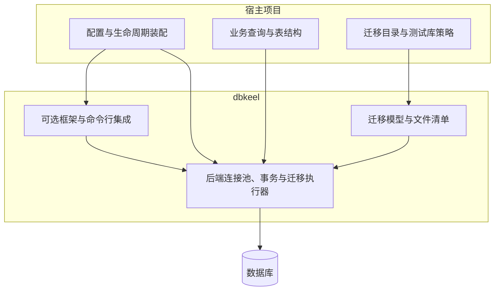

# dbkeel 开源库建设计划

## 状态与目标

- 状态：待确认；本文定义目标方案与实施顺序，确认后进入实现。
- 名称：`dbkeel`，发行包名与 Python 导入名保持一致。
- 定位：轻量级 Python 异步数据库基础设施，提供连接池、事务管理与 SQL 迁移。
- 仓库描述：`Lightweight async database infrastructure for Python, with connection pooling, transaction management, and SQL migrations.`
- 来源：slash_space 项目 `src/infra/db/`，当前设计见其 `docs/designs/infrastructure/database/overview.md`。

数据库后端是可扩展边界。首版提取已有 PostgreSQL 实现；其他后端在有真实使用场景时接入，首版不承诺已经支持。公共包名、核心迁移模型与宿主接入方式保持后端中立。

## 目标架构



### 职责分配

| 能力 | dbkeel | 宿主项目 |
| --- | --- | --- |
| 配置 | 后端配置模型与校验 | 环境变量读取、配置来源、实例装配 |
| 生命周期 | 连接池打开、关闭与资源释放 | Web、CLI、Worker 启停时机 |
| 数据库访问 | 原生连接、游标与事务上下文 | 业务 SQL、结果映射与事务边界选择 |
| 迁移发现 | 显式来源目录、命名空间、稳定排序与清单解析 | 本项目目录布局到迁移来源的映射 |
| 迁移执行 | 计划、校验和、执行记录、后端并发协调 | 执行时机、目标数据库与部署流程 |
| 测试数据 | 迁移执行机制 | 测试库身份、数据来源与执行限制 |
| 框架集成 | 接收显式依赖的可选集成 | FastAPI 依赖别名与应用配置连接 |
| 错误 | 明确的基础设施异常与后端异常映射 | 业务异常及 HTTP 响应映射 |

### 提取范围

| 来源模块或资源 | 目标处理 |
| --- | --- |
| `postgres/engine.py`、`postgres/schemas.py` | 提取至后端模块，整理生命周期与配置接口 |
| `migrations.py` | 提取通用模型、文件加载、清单与排序；移出固定项目目录约定 |
| `postgres/migrations.py` | 提取后端迁移执行器，明确锁与失败恢复契约 |
| `errors.py` | 区分通用错误与后端翻译，保留原始异常链 |
| `engines.py`、`schemas.py` | 主库、测试库与默认后端装配首版留在宿主，按需使用库的配置模型 |
| `postgres/deps.py` | 宿主保留装配；通用依赖工厂可进入可选 FastAPI 集成 |
| `cli.py` | 宿主保留现有命令兼容；库提供不依赖宿主配置的命令工厂或执行 API |
| `postgres/migrations/*.sql` 与现有清单 | 留在宿主，保持历史迁移身份和文件内容 |
| 数据库基础设施测试 | 通用行为迁入库；业务表与本项目装配测试留在宿主 |

标签、Outbox、任务执行表及公共触发器函数属于宿主的数据库结构，库安装或初始化不会自动创建这些对象。库仅按显式操作管理自身迁移记录表。

## 包与依赖设计

```text
dbkeel/
├── pyproject.toml
├── src/dbkeel/
│   ├── __init__.py
│   ├── errors.py
│   ├── migrations/          # 通用模型、来源、清单与文件加载
│   ├── postgres/            # 配置、连接池、事务、迁移执行与错误翻译
│   └── integrations/        # 按需提供 FastAPI、CLI 集成
├── tests/
│   ├── unit/
│   └── integration/
├── examples/
├── docs/
└── .github/workflows/
```

- 使用 uv 管理项目，采用 `src` 布局，提供 wheel、sdist 和类型标记 `py.typed`。
- 首版以 Python 3.12 为兼容基线，最终支持范围由 CI 实测确定。
- 后端驱动与框架使用可选依赖组，例如 `dbkeel[postgres]`、`dbkeel[fastapi]`、`dbkeel[cli]`。
- 导入核心包不应强制导入可选后端或框架；安装对应依赖后才使用相关模块。
- 配置模型可沿用 Pydantic；宿主的环境变量前缀和加载机制不进入公共契约。
- 原生连接和游标由各后端模块公开；首版不定义跨驱动通用游标、统一 SQL 方言或 ORM。
- 许可证确定为 MIT（本仓库 `LICENSE`）；依赖的许可要求在首次公开发布前完成检查。

## 公共契约

| 主题 | 目标约定 |
| --- | --- |
| 依赖方向 | 库不导入宿主的 `src.config`、业务模块或管理入口 |
| 引擎构造 | 显式传入配置；导入模块不创建连接池、不读取宿主环境 |
| 事务 | 文档明确普通连接的隐式事务、显式事务、嵌套事务及 autocommit 行为 |
| 生命周期 | 明确事件循环归属、并发首次初始化、重复关闭、初始化失败与取消后的资源处理 |
| 配置安全 | 使用驱动提供的连接参数构造能力，覆盖特殊字符；配置展示和错误消息不泄露凭据 |
| 迁移来源 | 显式传入根目录、命名空间与来源目录；不假定 `src/apps/` 布局 |
| 文件安全 | 清单使用可移植相对路径，解析后校验根目录边界，包括符号链接越界 |
| 执行顺序 | 保持稳定排序与清单顺序，拒绝重复迁移 ID |
| 历史校验 | 保持 SHA-256 计算规则，禁止静默修改已执行迁移 |
| 计划结果 | 用 `pending`、`applied` 等明确状态区分待执行与已执行，计划查询不创建表 |
| 并发迁移 | 后端定义协调机制、稳定锁范围与等待超时；多个实例执行同一迁移序列时互斥 |
| 迁移失败 | 事务迁移与记录原子提交；非事务迁移明确部分执行及人工恢复流程 |
| 错误翻译 | 明确何处显式翻译，保留原始异常链及排障方式，不自动吞掉驱动异常 |

迁移锁默认命名去除项目品牌。宿主切换期间，新旧迁移执行入口必须使用兼容锁键，或通过发布流程保证不并行运行；仅保留迁移记录表不足以保证滚动切换时互斥。

## 宿主兼容策略

- `src/infra/db/` 在过渡期作为薄适配层，统一转发到 dbkeel，避免维护两套执行实现。
- 保持现有主库、测试库隔离与 Web 生命周期只打开主库的行为。
- 保持现有 CLI 参数与目录扫描结果，宿主将目录约定转换为显式迁移来源。
- 保持已执行迁移的 ID、SQL 字节内容、校验和、执行顺序和记录表位置；移动代码不能触发历史 SQL 重跑。
- 库内公共 API 可以整理命名；宿主适配层承担旧导入路径与状态展示的兼容。
- 锁定经过验证的库版本，升级通过 uv 锁文件管理；发布回退使用已验证的代码与依赖版本，不自动回滚数据库结构。

## 实施阶段


| 阶段 | 交付物 | 验收条件 |
| --- | --- | --- |
| 1. 方案确认 | 提取范围、首版 API 清单、许可证与支持范围 | 用户确认方案；名称占用与仓库地址完成核实 |
| 2. 核心提取 | 独立包、后端模块、迁移模型与显式来源配置 | 不依赖本项目源码，基础安装不加载可选依赖 |
| 3. 独立验证 | 生命周期与迁移测试、最小示例、构建产物 | 从构建产物安装后可运行；独立项目无需本项目配置即可接入 |
| 4. 宿主接入 | 薄适配层、依赖锁定、业务与命令回归 | 迁移计划与历史校验一致，数据库访问及测试隔离行为兼容 |
| 5. 首版发布 | README、API 文档、变更记录、CI 与发布流程 | 许可证及版本就绪，支持矩阵通过，发布产物可安装 |

开发阶段可使用 uv 本地路径依赖联调；发布版本使用可复现的版本依赖。GitHub 仓库和 PyPI 的外部写入按实际授权执行，本计划不视为发布授权。

## 验证方案

| 验证层 | 重点 |
| --- | --- |
| 单元测试 | 配置、清单边界、排序、重复 ID、校验和、错误映射与计划状态 |
| 运行时集成 | 提交与回滚、autocommit 恢复、并发初始化、连接池关闭及取消处理 |
| 迁移集成 | 执行与跳过、失败回滚、历史校验、并发互斥、锁超时与释放、非事务迁移失败 |
| 宿主回归 | 主库和测试库装配、FastAPI 依赖、管理命令、关键业务数据库访问 |
| 分发验证 | wheel 与 sdist 内容、干净环境安装、可选依赖组合、类型标记与示例 |

来源项目的 PostgreSQL 集成测试沿用固定测试库、运行前完成迁移、最外层事务回滚的规则，不永久清理或修改测试库。迁移提交、非事务 SQL 和跨进程锁测试使用独立 CI 的一次性数据库资源；不借固定测试库突破回滚约束。

## 确认要点与后续范围

| 项目 | 本计划建议 |
| --- | --- |
| 首版后端 | 提取已有 PostgreSQL；为其他后端保留模块边界 |
| 数据库访问风格 | 保持显式 SQL 与驱动原生对象 |
| 框架与 CLI | 可选集成，宿主装配独立 |
| 迁移路径 | 显式来源配置，宿主保留现有扫描约定 |
| 首版许可证 | MIT（已确定） |
| 其他数据库 | 有真实接入需求后单独设计，并通过对应后端测试 |
| 暂不纳入 | ORM、通用 Repository、自动 SQL 方言转换、自动回滚迁移、读写分离、多租户路由 |

实施完成后，将宿主的实际职责与接入方式同步到来源项目的数据库基础设施总览及对应核心流程文档，库的 API 与发布文档在本仓库维护。
