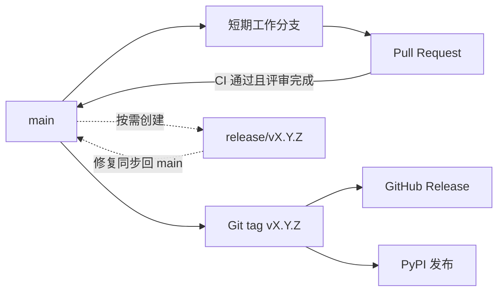

# 分支规范

`dbkeel` 采用 **`main` + 短期工作分支 + Git tag** 的模式。



## 分支

- `main`：稳定、可测试、可发布的唯一长期分支。
- `feature/*`、`fix/*`、`docs/*`、`refactor/*`、`test/*`、`chore/*`：短期工作分支，合并后删除。
- `release/vX.Y.Z`：发布收口时按需使用，发布后删除。
- 不建立长期 `dev` 分支，不直接向 `main` 推送变更。

## 命名

```text
<type>/<scope>-<summary>
```

示例：`feature/postgres-engine`、`fix/migration-lock`、`docs/installation`。

- 使用小写英文字母、数字和连字符 `-`。
- 每个分支只处理一个目标。
- 不使用日期、开发者名称或 `temp`、`test1` 等模糊名称。
- 已发布版本修复使用 `fix/vX.Y.x-<summary>`，从对应的维护基线创建分支。

## 日常开发

1. 从最新的 `main` 创建工作分支。
2. 完成目标并执行受影响的检查。
3. 创建 Pull Request，说明变更和测试结果。
4. CI 通过并完成评审后合入 `main`。
5. 合并后删除工作分支。

公共 API、配置或行为变化时同步更新文档；修复问题时补充回归测试。

## 发布

- 从经过验证的发布提交创建 `vMAJOR.MINOR.PATCH` tag，并使用相同版本号发布 GitHub Release 和 PyPI 包。
- `MAJOR` 表示不兼容变更，`MINOR` 表示兼容功能增加，`PATCH` 表示兼容修复。
- 已推送的 tag 不修改、不复用。
- 需要发布收口且 `main` 继续开发时，使用 `release/vX.Y.Z`；该分支只处理版本、文档、测试和发布阻断问题。
- 发布分支上的修复应同步回 `main`；发布完成后删除发布分支。

## Pull Request

- 标题准确，正文说明变更、测试和风险。
- 未通过 CI 或未完成评审的 Pull Request 不得合并。
- 合并前处理冲突并重新执行受影响的检查。
- 优先使用 squash merge，保持 `main` 历史清晰。
